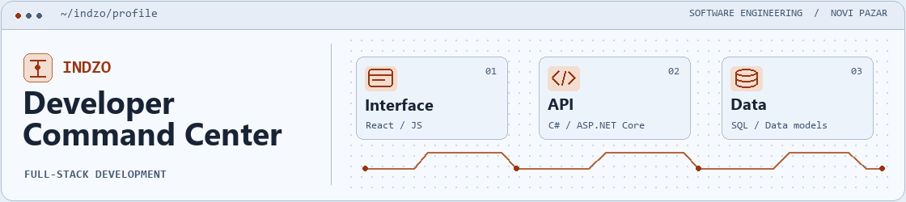
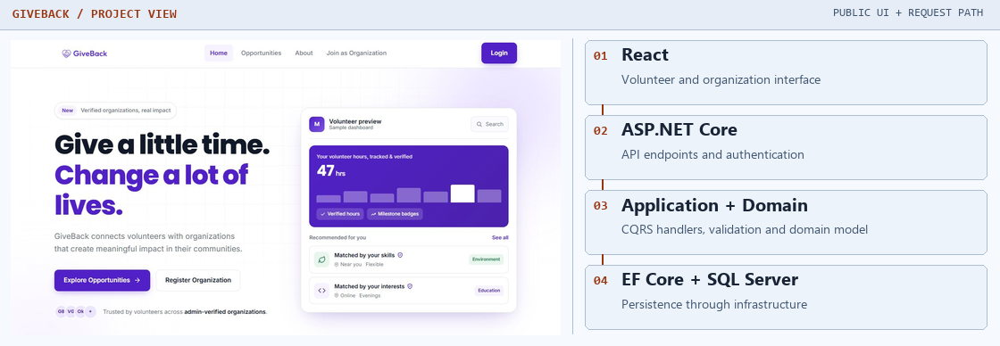
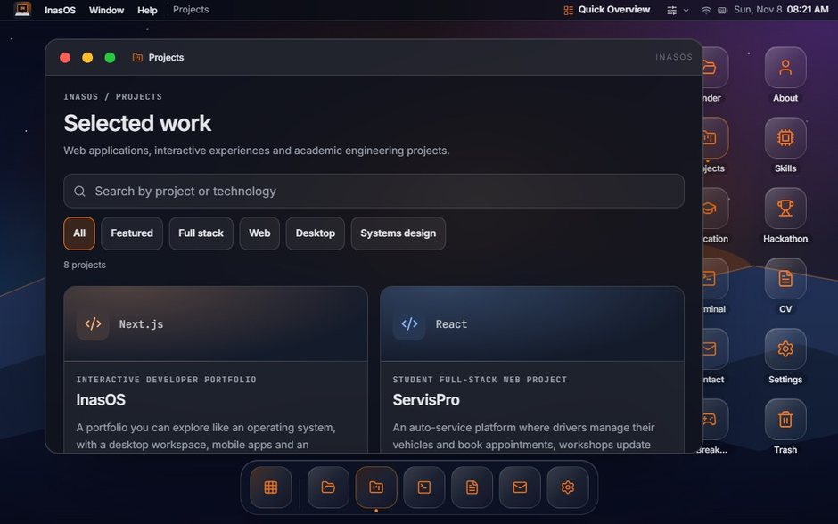
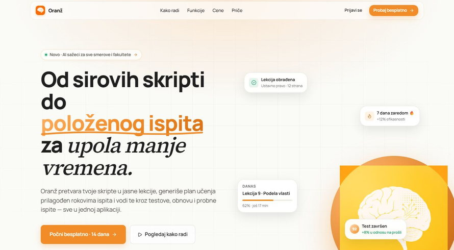
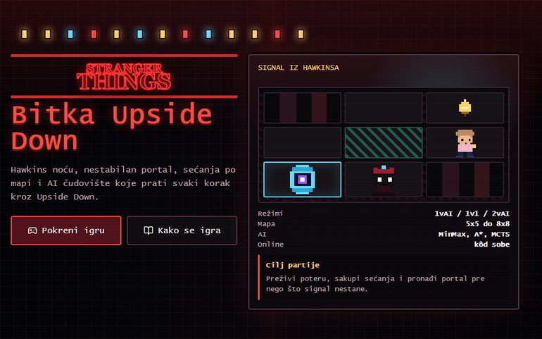
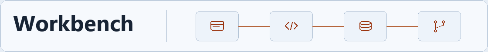

<picture>
  <source media="(max-width: 560px) and (prefers-color-scheme: dark)" srcset="assets/workspace-mobile-dark.png">
  <source media="(max-width: 560px)" srcset="assets/workspace-mobile-light.png">
  <source media="(prefers-color-scheme: dark) and (prefers-reduced-motion: no-preference)" srcset="assets/workspace-dark.gif">
  <source media="(prefers-color-scheme: light) and (prefers-reduced-motion: no-preference)" srcset="assets/workspace-light.gif">
  <source media="(prefers-color-scheme: dark)" srcset="assets/workspace-dark.png">
  
</picture>

# Inas Hamzagić

**Software Engineering Student & Developer**  
I build full-stack web apps and like following a feature from the first interface sketch through its API and data model. My core stack is **React, JavaScript, C#, ASP.NET Core, and SQL**.

[DIYAR client project](#diyar) · [Featured work](#featured-work) · [Engineering stack](#engineering-stack) · [Live portfolio](https://hamzagicinas.vercel.app/) · [GitHub projects](https://github.com/INDZO?tab=repositories) · [Contact](#contact)

## Featured work

### DIYAR

**Independent client delivery · Real estate**

I handled client communication, prototyping, brand identity, and interface design. I built and delivered the property listing site, its admin tools, and Gemini-powered translation.

[Visit the client website ↗](https://diyar.rs/) · Next.js, TypeScript, Drizzle ORM, PostgreSQL, Gemini

<picture>
  <source media="(max-width: 560px)" srcset="assets/diyar-mobile.jpg">
  
</picture>

### GiveBack

**Independent full-stack academic project · Volunteer coordination**

GiveBack lets organizations publish opportunities and volunteers find them. I designed the relational database and built the React frontend and ASP.NET Core backend. The backend uses **Clean Architecture** and **CQRS**, with MediatR for commands and queries and EF Core for SQL Server persistence.

<picture>
  <source media="(max-width: 560px)" srcset="assets/giveback.jpg">
  <source media="(prefers-color-scheme: dark)" srcset="assets/giveback-system.jpg">
  
</picture>

[Live Demo ↗](https://giveback-frontend.vercel.app/)

### InasOS

**Interactive portfolio · AI-assisted development**

I built a browser-based desktop with apps, a dock, and a searchable Projects window. AI-assisted iteration helped me refine the interface and navigation between views.

<picture>
  <source media="(prefers-reduced-motion: no-preference)" srcset="assets/inasos-projects.gif">
  
</picture>

[Open InasOS ↗](https://hamzagicinas.vercel.app/) · [Public source ↗](https://github.com/INDZO/InasOS)  
Next.js, React, TypeScript, Zustand, Framer Motion

### Oranž

**AI-assisted study platform · Team project**

We built an AI-assisted tool that turns course materials into structured study sessions. I proposed the concept we chose, tested the app, helped present the technical solution, and initiated the live QR-based demo. Our team placed first at the 2026 UNINP Hackathon.

[Visit the team's product ↗](https://www.oranz.study/) · Next.js, TypeScript, Supabase

## More engineering work

### ServisPro

I independently built a service-booking platform for customers, workshops, and administrators with a **React** frontend, an **ASP.NET Core REST API**, and **SQL Server**.

[Browse the public documentation ↗](https://github.com/INDZO/Softversko-Inzenjerstvo-2026) · Requirements, architecture, models, testing, and user guide.

### Bitka Upside Down

A turn-based 8-bit chase game built for a university AI project. The Django backend manages rules, maps, timers, and statistics, with SQLite for persistence. React receives live updates over **WebSockets** via Django Channels, with a REST fallback. The project explores **Minimax, alpha–beta pruning, A\*, and Monte Carlo tree search**.

[Open the Render demo ↗](https://bitka-upside-down.onrender.com/) · Availability can vary.

Game screenshot

Earlier projects

- **[tele.com](https://indzo.github.io/tele.com/)** · Multi-page telecom website built with HTML, CSS, and JavaScript. [Public source](https://github.com/INDZO/tele.com)
- **[IS Biblioteka](https://github.com/INDZO/IS_Biblioteka-master)** · C# and Windows Forms application for managing books, members, and lending.
- **ElitDent** · Academic application for dental clinic workflows, built with Laravel, Angular, and MySQL.

## Engineering stack

<picture>
  <source media="(prefers-color-scheme: dark)" srcset="assets/workbench-dark.png">
  
</picture>

| Area | What I use |
| --- | --- |
| <picture></picture> **Frontend** | React, JavaScript, HTML, and CSS for web interfaces. |
| <picture></picture> **Backend & APIs** | C# and ASP.NET Core for REST APIs and application logic. |
| <picture></picture> **Data & architecture** | SQL and relational modeling. Clean Architecture and CQRS in [GiveBack](#giveback). |
| <picture></picture> **Tools & workflow** | Git and GitHub for version control. AI-assisted prototyping and interface iteration in [InasOS](#inasos). |

**Additional project experience** · TypeScript, PHP, Python, Angular, and Laravel.

## About

**Novi Pazar, Serbia** · Final-year Software Engineering student at the State University of Novi Pazar.

I’m especially interested in algorithms, data structures, and practical AI integration.

[Public GitHub activity ↗](https://github.com/INDZO) · Some projects live in private repositories.

## Contact

<picture>
  <source media="(prefers-color-scheme: dark)" srcset="assets/contact-dark.png">
  
</picture>

Open to internships, junior developer roles, and collaboration.

**Work** · [Live portfolio ↗](https://hamzagicinas.vercel.app/) · [GitHub ↗](https://github.com/INDZO)  
**Contact** · [LinkedIn ↗](https://www.linkedin.com/in/hamzagicinas/) · [hamzagicinas@gmail.com](mailto:hamzagicinas@gmail.com)
