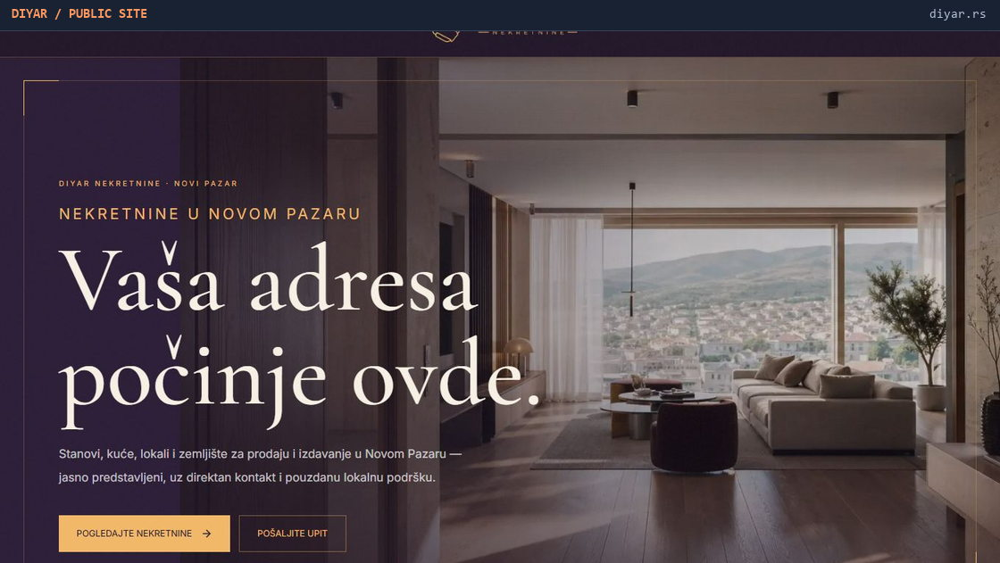
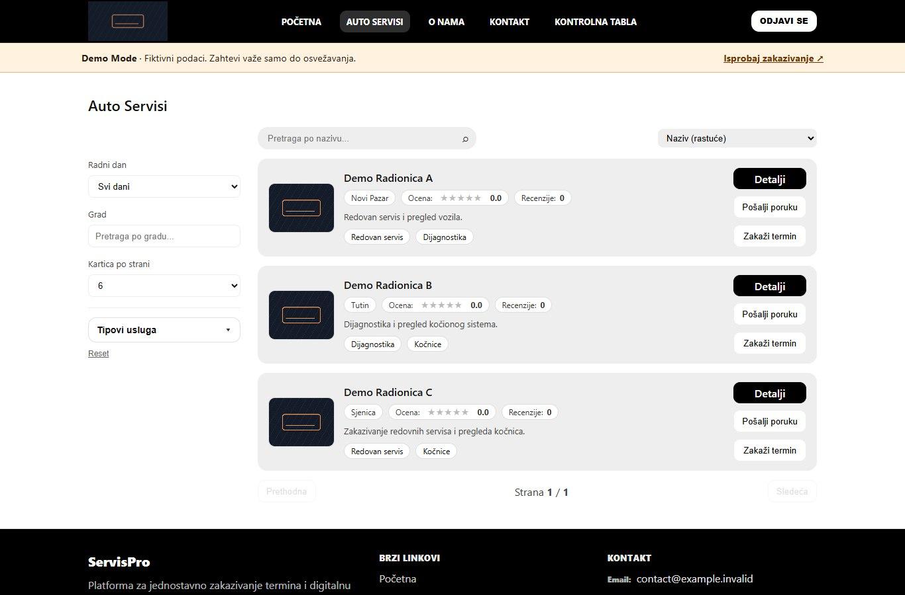
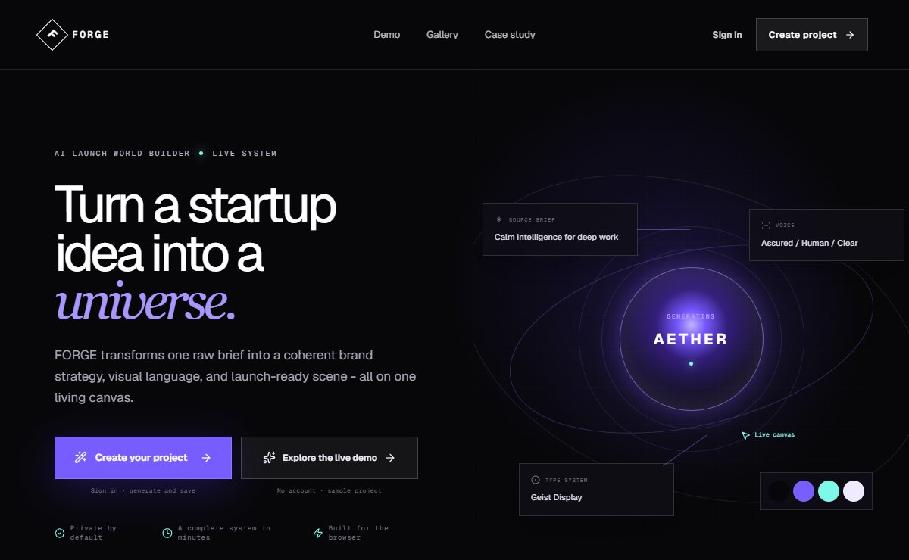
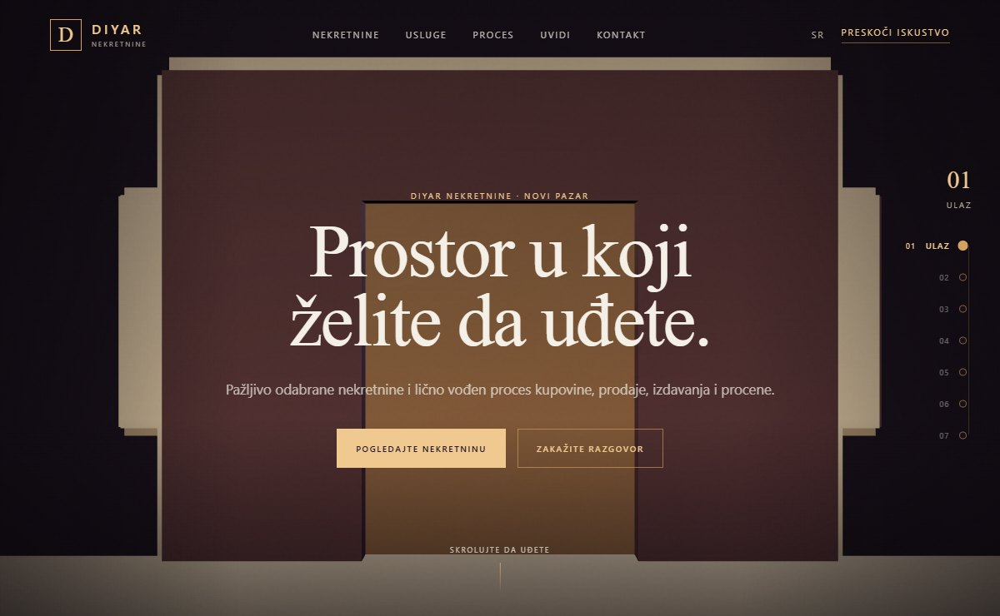

<picture>
  <source media="(max-width: 560px) and (prefers-color-scheme: dark)" srcset="assets/workspace-mobile-dark.png">
  <source media="(max-width: 560px)" srcset="assets/workspace-mobile-light.png">
  <source media="(prefers-color-scheme: dark) and (prefers-reduced-motion: no-preference)" srcset="assets/workspace-dark.gif">
  <source media="(prefers-color-scheme: light) and (prefers-reduced-motion: no-preference)" srcset="assets/workspace-light.gif">
  <source media="(prefers-color-scheme: dark)" srcset="assets/workspace-dark.png">
  
</picture>

# Inas Hamzagić

**Software Engineering Student | Full-Stack Developer**  
I build full-stack web apps, from interface design to APIs and relational data models. My core stack is **React, ASP.NET Core, C#, and SQL**.

[DIYAR client project](#diyar) · [Featured engineering](#featured-engineering) · [Academic & applied](#academic--applied-projects) · [Creative Lab](#creative-lab) · [Engineering stack](#engineering-stack) · [Live portfolio](https://hamzagicinas.vercel.app/) · [Resume](#resume--opportunities) · [GitHub projects](https://github.com/INDZO?tab=repositories) · [Contact](#contact)

## Resume & Opportunities

<table>
  <tr>
    <td>
      🟠 <strong>One-page resume</strong> 
      Explore my education, technical skills, client work, and selected engineering projects.  
      <strong><a href="https://github.com/INDZO/INDZO/blob/main/resume/Inas_Hamzagic_Resume.pdf">View Resume ↗</a></strong>
      &nbsp;·&nbsp;
      <a href="https://github.com/INDZO/INDZO/raw/refs/heads/main/resume/Inas_Hamzagic_Resume.pdf?download=1">Download PDF ↓</a>  
      <strong><a href="https://hamzagicinas.vercel.app/">Explore InasOS ↗</a></strong>
      &nbsp;·&nbsp; Interactive developer portfolio
    </td>
  </tr>
</table>

## Featured engineering

### DIYAR

**Independent client delivery · Real estate**

I handled client communication, prototyping, brand identity, and interface design. I built and delivered the property listing site, its admin tools, and Gemini-powered translation.

[Visit the client website ↗](https://diyar.rs/) · [Engineering showcase ↗](https://github.com/INDZO/DIYAR-Showcase)

<picture>
  <source media="(max-width: 560px)" srcset="assets/diyar-mobile.jpg">
  
</picture>

### ServisPro

**Software Engineering · Full-stack workshop booking**

I built a React client and ASP.NET Core REST API for customers, workshops, and administrators, with SQL Server and EF Core behind the booking and service history flows.

[Source code ↗](https://github.com/INDZO/ServisPro-Source) · [Engineering documentation ↗](https://github.com/INDZO/Softversko-Inzenjerstvo-2026) · [Live frontend demo ↗](https://indzo-servispro-demo.vercel.app/) · Runs entirely in the browser with fictional data that resets on refresh.

### GiveBack

**Advanced Databases · Volunteer coordination**

I designed the relational model and built a React client and ASP.NET Core API for coordinating volunteers and opportunities. The API uses **Clean Architecture**, **CQRS** with MediatR, and EF Core with SQL Server.

<picture>
  <source media="(max-width: 560px)" srcset="assets/giveback.jpg">
  <source media="(prefers-color-scheme: dark)" srcset="assets/giveback-system.jpg">
  
</picture>

[Full-stack source ↗](https://github.com/INDZO/GiveBack-Source) · [Engineering showcase ↗](https://github.com/INDZO/GiveBack-Showcase) · [Hosted frontend ↗](https://giveback-frontend.vercel.app/)

### InasOS

**Interactive portfolio · AI-assisted development**

I built a browser-based desktop with apps, a dock, and a searchable Projects window. AI-assisted iteration helped me refine the interface and navigation between views.

<picture>
  <source media="(prefers-reduced-motion: no-preference)" srcset="assets/inasos-projects.gif">
  
</picture>

[Open InasOS ↗](https://hamzagicinas.vercel.app/) · [Public source ↗](https://github.com/INDZO/InasOS) · [Engineering guide ↗](https://github.com/INDZO/InasOS/wiki)

## Academic & applied projects

### Bitka Grid Chase

**Artificial Intelligence** · React and Django Channels power a turn-based game that implements Minimax, alpha–beta pruning, A*, and Monte Carlo tree search.

[Source code ↗](https://github.com/INDZO/Bitka-Grid-Chase) · [Screenshot and local preview ↗](https://github.com/INDZO/Bitka-Grid-Chase#preview) · [Original Render demo ↗](https://bitka-upside-down.onrender.com/)

Game screenshot

### ElitDent

**Information Systems · Internet Application Programming** · Dental appointment and practice workflows built with Laravel, Angular, and MySQL. The repository includes the original requirements and data models.

[Source and seminar paper ↗](https://github.com/INDZO/ElitDent-Source) · [Live frontend demo ↗](https://indzo-elitdent-demo.vercel.app/) · Fictional data that resets on refresh.

### eSufara

**Object-Oriented Programming 2** · C# and WPF course player with account-based progress tracked through EF Core.

[Source code ↗](https://github.com/INDZO/eSufara)

### tele.com

**Web Design** · A multi-page telecom storefront built with HTML, CSS, and JavaScript.

[Source code ↗](https://github.com/INDZO/tele.com) · [Live site ↗](https://indzo.github.io/tele.com/)

### IS Biblioteka

**Independent high-school graduation project** · A C# Windows Forms application for books, members, and lending.

[Source code ↗](https://github.com/INDZO/IS_Biblioteka-master)

## Creative Lab

### FORGE

A cinematic AI launch world builder that turns a product brief into a brand concept. Built with Next.js and TypeScript.

[Open FORGE ↗](https://forge-world-builder.vercel.app/)

### DIYAR 3D

A scroll-led real-estate walkthrough for DIYAR, built with HTML, CSS, and JavaScript.

[Open DIYAR 3D ↗](https://3d-model-walktrough.vercel.app/)

## Collaboration

### Oranž

**AI-assisted study platform · Team project**

We built an AI-assisted tool that turns course materials into structured study sessions. I proposed the concept we chose, tested the app, helped present the technical solution, and initiated the live QR-based demo. Our team placed first at the 2026 UNINP Hackathon.

[Visit the team's product ↗](https://www.oranz.study/)

## Engineering stack

<picture>
  <source media="(prefers-color-scheme: dark)" srcset="assets/workbench-dark.png">
  
</picture>

| Area | What I use |
| --- | --- |
| <picture></picture> **Frontend** | React, JavaScript, HTML, and CSS for web interfaces. |
| <picture></picture> **Backend & APIs** | C# and ASP.NET Core for REST APIs and application logic. |
| <picture></picture> **Data & architecture** | SQL and relational modeling. Clean Architecture and CQRS in [GiveBack](#giveback). |
| <picture></picture> **Tools & workflow** | Git and GitHub for version control. AI-assisted prototyping and interface iteration in [InasOS](#inasos). |

**Additional project experience** · TypeScript, PHP, Python, Angular, and Laravel.

## About

**Novi Pazar, Serbia** · Final-year Software Engineering student at the State University of Novi Pazar.

Beyond web development, I work on desktop applications and enjoy exploring software architecture, algorithms, data structures, and practical uses of AI.

[Public GitHub activity ↗](https://github.com/INDZO) · Some projects live in private repositories.

## Contact

<picture>
  <source media="(prefers-color-scheme: dark)" srcset="assets/contact-dark.png">
  
</picture>

Open to internships, junior developer roles, and collaboration.

**Work** · [Live portfolio ↗](https://hamzagicinas.vercel.app/) · [GitHub ↗](https://github.com/INDZO)  
**Contact** · [LinkedIn ↗](https://www.linkedin.com/in/hamzagicinas/) · [hamzagicinas@gmail.com](mailto:hamzagicinas@gmail.com)
